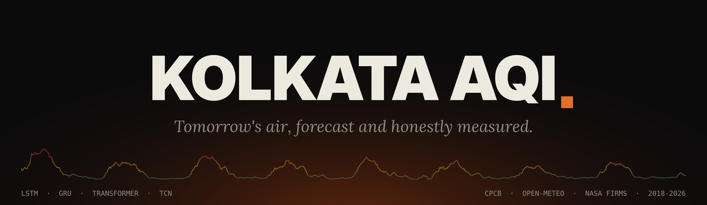
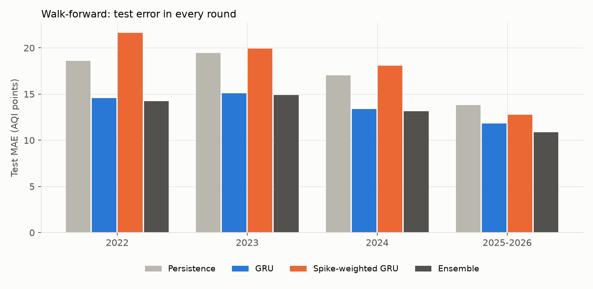
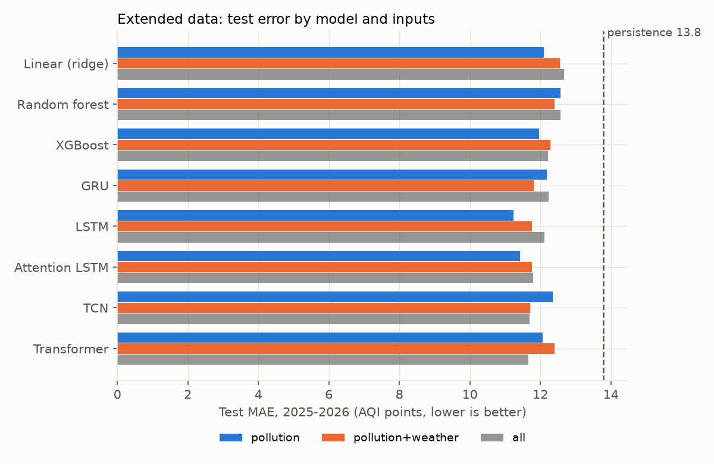
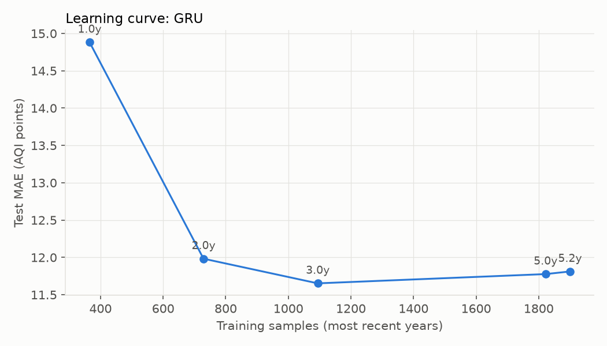
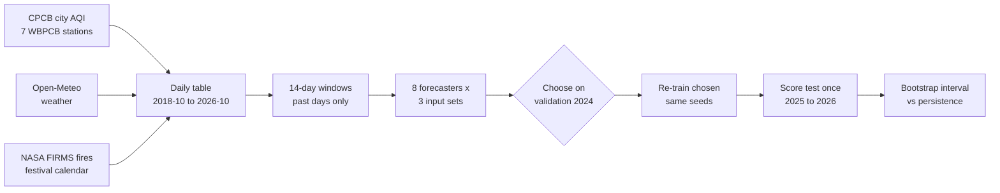
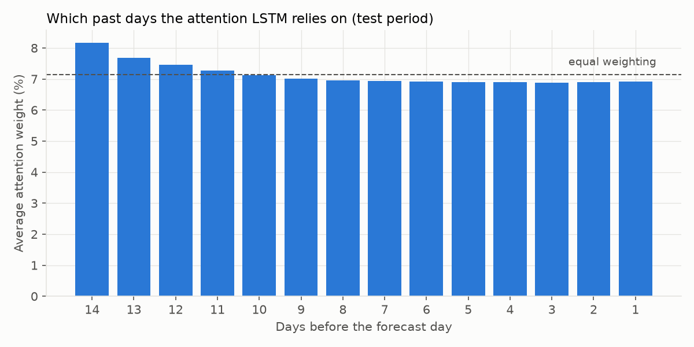
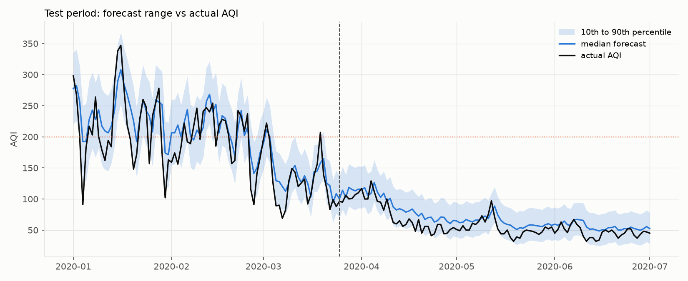

<div align="center">



# Kolkata AQI Forecasting

**Forecast tomorrow's Air Quality Index for Kolkata with deep learning, and measure it honestly.**

[](https://www.python.org/)
[](https://pytorch.org/)
[](tests)
[](#data)
[](#about)

</div>

---

## What is this?

Every winter, Kolkata's air turns "Poor" or worse for weeks at a time. A forecast one day ahead
gives people time to act: keep children indoors, avoid a morning run, plan around the worst days.

This project forecasts **tomorrow's AQI** from the previous 14 days of air-quality data, and raises
a **high-pollution alert** when the forecast is above 200 (CPCB "Poor" or worse). It compares
**eight forecasters**, from linear regression to Transformers, against the simplest possible
forecast, **persistence** ("tomorrow will be like today"), and only claims a model is better when
a statistical test says so.

It was built in two stages:

1. **Kaggle data, 2018 to 2020** (747 days). The deep networks were starved of data: the best
   model on test was plain ridge regression.
2. **Official data, 2018 to 2026** (2,953 days), collected from the Central Pollution Control
   Board, Open-Meteo and NASA. With four times more data, **deep learning clearly wins**, and a
   learning curve shows exactly how much data it needed.

---

## Results at a glance

**Test period: 1 Jan 2025 to 31 Oct 2026 (669 days), scored once, after every choice was made on 2024.**

| | Test MAE (AQI points) | vs persistence [95% interval] |
|---|---|---|
| Persistence (tomorrow = today) | 13.8 | baseline |
| **GRU, pollution + weather** (chosen on validation) | **11.8** | **-2.0 [-3.2, -0.7], 14% better** |
| Best single test score: LSTM, pollution only | 11.2 | -2.6 [-3.6, -1.5] |

- **All 24** forecaster and input combinations beat persistence, with 95% intervals entirely below zero.
- **Neural networks lead** (test MAE 11.2 to 12.4) over ridge regression and tree models (12.0 to 12.7).
- **More data is what mattered.** Trained on only the most recent year, the chosen GRU scores 14.9,
  worse than persistence; with 3 years it reaches 11.7, after which it levels off.
- Forecasting further ahead: **3 days** 19.9 vs 22.2, **7 days** 22.4 vs 25.2 for persistence.
- The **80% forecast range** contained the real AQI on **92%** of test days.

**Does it hold up in other years? Yes.** The whole procedure was repeated in four walk-forward
rounds, each trained only on earlier data:

| Test period | Persistence | GRU | Ensemble (GRU + LSTM + Transformer + XGBoost) |
|---|---|---|---|
| 2022 | 18.6 | **14.6** | **14.2** |
| 2023 | 19.5 | **15.1** | **14.9** |
| 2024 | 17.0 | **13.4** | **13.1** |
| 2025 to 2026 | 13.8 | **11.8** | **10.9** |
| **All 1,764 days** | | **-3.2 [-4.0, -2.4]** | **-3.8 [-4.5, -3.0]** |

Both beat persistence with 95% confidence in **every** round; the last row is the pooled
difference in test MAE. The ensemble was the most accurate model in all four.

<div align="center">



</div>

<div align="center">





</div>

Full tables: [`reports/extended_results.md`](reports/extended_results.md).

---

## Features

- **Eight forecasters, one fair contest**: ridge regression, random forest, XGBoost, GRU, LSTM,
  attention LSTM, temporal convolutional network (TCN) and Transformer, all on the same days and
  the same date split.
- **Three input sets**: pollution only; plus 12 daily weather variables; plus satellite fire
  counts, festivals (Kali Puja, Durga Puja, Holi, New Year) and the 2020 lockdown.
- **Interpretable attention**: the attention LSTM shows which of the past 14 days it relied on.
- **Forecast ranges**: a quantile network predicts the 10th, 50th and 90th percentile with the
  pinball loss, built so the three can never cross, and supports a cautious alert.
- **1, 3 and 7 days ahead**, and a **learning curve** that measures the value of more data.
- **Honest evaluation**: chronological split, no data leakage, choices made on validation only,
  test scored once, 95% block-bootstrap intervals for every comparison.
- **Walk-forward testing** over four separate years (2022, 2023, 2024, 2025-2026), plus a
  pre-declared **ensemble**, a **spike-weighted** GRU for polluted days, and a calibrated
  **probability of a high-pollution day**.
- **Runs on an NVIDIA GPU** in deterministic mode, so the same machine gives the same numbers
  every run; falls back to CPU automatically.
- **43 automated checks** for the research rules: no future data in any input, the target never
  filled in, train-only scaling, causal convolutions, and more.

---

## How it works



1. **Build one daily table.** The official city AQI is the target; pollutant inputs are the mean
   of the stations reporting each day. Short input gaps (at most 7 days) are carried forward and
   flagged. The target is **never** filled in: a day without an official AQI is simply never used
   as a forecast target.
2. **Make samples.** Each sample is the previous 14 days of inputs, labelled with the next day's
   AQI. Windows only look backwards; festival flags describe the forecast day, which is known from
   the calendar in advance.
3. **Split by date, never at random.** Train 2018-10 to 2023, validation all of 2024 (every
   season), test 2025-01-01 to 2026-10-31. The scaler is fitted on training data only.
4. **Choose on validation.** Every forecaster has a short list of settings fixed in
   [`src/config.py`](src/config.py) before any run. Models with randomness train with several
   seeds; the setting with the lowest mean validation error wins. All choices are saved to disk
   before the test period is touched.
5. **Score the test period once**, against persistence on exactly the same days, with a 95%
   block-bootstrap interval for the difference in error.

---

## Data

| Source | What | Period |
|---|---|---|
| [CPCB CCR portal](https://airquality.cpcb.gov.in/ccr), AQI data repository | Official daily city AQI for Kolkata (4 PM bulletin), the **forecast target** | 2018 to 2026 |
| [CPCB CCR portal](https://airquality.cpcb.gov.in/ccr), CAAQMS data repository | 24-hour pollutant readings from 7 WBPCB stations: Ballygunge, Bidhannagar, Fort William, Jadavpur, Rabindra Bharati University, Rabindra Sarobar, Victoria | 2018 to 2026 |
| [Open-Meteo Historical Weather](https://open-meteo.com/en/docs/historical-weather-api) | 12 daily variables for central Kolkata: temperature (mean, max, min), rain, wind, wind direction, sunlight, humidity, dew point, pressure | 2018 to 2026 |
| [NASA FIRMS](https://firms.modaps.eosdis.nasa.gov/download/), VIIRS S-NPP | Vegetation fire detections, 82-92 E, 20-28 N, summarised per day | 2018 to 2026 |
| [Kaggle: Air Quality Data in India](https://www.kaggle.com/datasets/rohanrao/air-quality-data-in-india) | `city_day.csv`, Kolkata rows (first stage of the project) | 2018 to 2020 |

Notes: boundary layer height was left out because Open-Meteo has no values for January to June
2024, the validation year, and values are never invented. The raw NASA file (123 MB) stays in
`data/raw/firms/`, outside Git; the daily summary is committed. Every cleaning decision is logged
in [`reports/preprocessing_decisions.md`](reports/preprocessing_decisions.md).

<details>
<summary><b>Kolkata's air is getting cleaner</b></summary>

Mean official AQI by year: 2019 about 136, 2021 about 124, 2023 about 105, 2025 about 99, and
2026 (to October) about 84. The test years are cleaner than most training years, which the
results and limitations take into account.

</details>

---

## Experiments

The project grew in five experiments. Each has one command and writes its own report.

| # | Experiment | Command | Report | Headline |
|---|---|---|---|---|
| 1 | LSTM vs persistence (Kaggle) | `python main.py train` then `evaluate` | [`results.md`](reports/results.md) | MAE 19.8 vs 20.5, not significant |
| 2 | 5 forecasters, with and without weather (Kaggle) | `python main.py compare` | [`model_comparison.md`](reports/model_comparison.md) | Ridge best on test; weather did not help |
| 3 | Attention LSTM, TCN, Transformer, forecast ranges (Kaggle) | `python main.py advanced` | [`advanced_results.md`](reports/advanced_results.md) | Transformer 18.0 vs 20.5, significant |
| 4 | **8 forecasters x 3 input sets on official 2018-2026 data** | `python main.py extended` | [`extended_results.md`](reports/extended_results.md) | **GRU 11.8 vs 13.8, significant** |
| 5 | **Walk-forward over 4 test years, ensemble, spike weighting, alert probability** | `python main.py robust` | [`robust_results.md`](reports/robust_results.md) | **GRU and ensemble win all 4 years** |

<div align="center">




</div>

---

## Install

Requires **Python 3.13 or newer**. An NVIDIA GPU is optional; everything also runs on CPU.

```powershell
git clone https://github.com/DebanganMALI/Kolkata-AQI-Forecasting.git
cd Kolkata-AQI-Forecasting
python -m venv .venv
.venv\Scripts\activate
python -m pip install --upgrade pip
pip install -r requirements.txt
```

**For the GPU**, replace the CPU-only PyTorch with the CUDA build (only an up-to-date NVIDIA driver
is needed, not the CUDA toolkit):

```powershell
pip uninstall -y torch
pip install torch==2.15.0 --index-url https://download.pytorch.org/whl/cu132
python -c "import torch; print(torch.cuda.is_available(), torch.cuda.get_device_name(0))"
```

On macOS or Linux, activate with `source .venv/bin/activate` and skip the CUDA step. If PowerShell
refuses to activate the environment, run
`Set-ExecutionPolicy -Scope Process -ExecutionPolicy RemoteSigned` first.

---

## Usage

```powershell
python -m unittest discover -s tests -v    # 43 research-rule checks

python main.py extended                    # headline experiment, about 35 min on an RTX 5070 Ti
python main.py robust                      # walk-forward over 4 test years, about 13 min (run after extended)

python main.py all                         # Kaggle pipeline: audit -> preprocess -> baseline -> train -> evaluate -> predict
python main.py compare                     # 5 forecasters, with and without weather
python main.py advanced                    # attention LSTM, TCN, Transformer, forecast ranges
python main.py predict --date 2020-01-15   # one forecast with its alert, compared with the real AQI
```

Add `--device cpu` to any command to force the CPU. The default, `--device auto`, uses the GPU
when PyTorch can see one.

Example forecast:

```text
 Kolkata next-day AQI forecast for 2020-01-15
 AQI on 2020-01-14 (last known day): 286
 Predicted AQI: 298  (Poor)  [LSTM, average of 5 runs; runs ranged 290-310]
 *** HIGH-POLLUTION ALERT: predicted AQI above 200 ***
 Actual AQI that day: 338  (Very Poor)
```

---

## Project layout

```text
data/
  raw/                 original files, never modified (Kaggle, CPCB city AQI + stations, NASA FIRMS)
  external/            Open-Meteo weather
  interim/             CPCB city AQI as one table, daily fire summary
  processed/           cleaned tables built by the code
models/                trained models, validation scores and saved choices for each experiment
reports/               every result as Markdown, plus figures/
src/
  config.py            every setting in one place: dates, features, candidates, device
  preprocessing.py     cleaning, chronological split, train-only scaling (Kaggle)
  extended_data.py     builds the 2018-2026 table from CPCB, Open-Meteo, NASA FIRMS, calendar
  dataset.py           14-day windows, target encoding, any horizon
  model.py             LSTM, GRU, device choice, deterministic GPU mode
  advanced_models.py   attention LSTM, temporal ConvNet, Transformer, pinball loss
  train.py             LSTM training with early stopping
  evaluate.py          metrics, alert scores, block bootstrap, figures
  compare.py           5-forecaster comparison with weather
  advanced.py          forecast ranges, attention weights, horizons
  extended.py          8 forecasters x 3 input sets, learning curve
  robust.py            walk-forward rounds, ensemble, spike-weighted GRU, alert probability
  weather.py           Open-Meteo reader
  predict.py           single-day forecast and alert
tests/                 43 checks for the research rules
main.py                command-line entry point
```

---

## Testing and research rules

The tests check the rules that keep the results honest:

- Raw data is never changed (the bytes of each source file are checked).
- No random split: train, validation and test are blocks of dates.
- Inputs only come from days **before** the forecast day, weather included.
- The target is never filled in; filled inputs are flagged.
- Scalers and target statistics are learned from training data only.
- Convolutions are causal: changing the most recent day never changes the network's view of
  earlier days.
- Quantile forecasts never cross; the GPU ridge regression matches scikit-learn exactly.

---

## Limitations

- Model settings were chosen once, on 2024, and reused in every walk-forward round; round 3 tests
  2024 itself, and round 4 re-scores the 2025-2026 period already reported.
- Weighting polluted days more (spike-weighted GRU) slightly reduced errors on the worst 20% of
  days but raised the overall error: a trade-off, not an overall improvement.
- The extended test years (2025-2026) have cleaner air than most training years.
- Only two stations reported in 2018, so the earliest city pollutant averages rest on fewer readings.
- Weather is reanalysis and fires are satellite detections: they show associations, not causes.
- Only past weather is used. A live system could add tomorrow's weather forecast.

---

## About

Group project for **Neural Networks and Deep Learning (PCCCS582)**, B.Tech Computer Science and
Engineering, Institute of Engineering and Management (IEM), Kolkata.

## Team

| Member | Contribution |
|---|---|
| **Debangan Mali** | Extended the project: collected the official 2018-2026 data (CPCB city AQI and 7 stations, Open-Meteo weather, NASA FIRMS fires, festival calendar) and built the extended pipeline; added the model comparison with weather, the advanced networks (attention LSTM, TCN, Transformer, forecast ranges, multi-horizon) and the learning curve; moved training to the GPU; ran all final experiments; wrote the documentation |
| **Sweta** | Started the project: chose the problem and the Kaggle dataset, wrote the dataset audit, preprocessing and chronological split, the persistence baseline, the first LSTM and its multi-seed experiment design, and the research-rule tests |
| **Tanisha** | Emotional support (details to be added) |
